<div align="center">

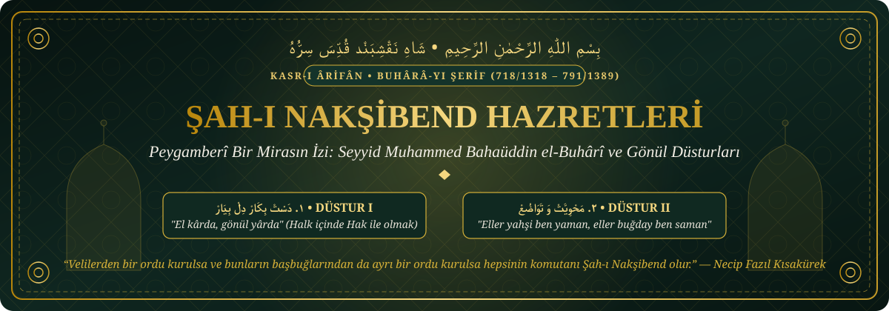

# 📜 Bahaüddin Nakşibend Arşivi (`bahauddin-naksibend-arsivi`)
### *Peygamberî Bir Mirasın İzi: Şah-ı Nakşibend Hazretleri ve Gönül Düsturları*

[](./02_Silsile-i_Zeheb/Tam_Silsile_Tablosu.md)
[](./03_Kelimat-i_Kudsiyye/11_Esas_Detayli_Aciklamasi.md)
[](./01_Hayati/)
[](./index.html)

> *"Zâhirimiz halk ile, bâtınımız Hak iledir."*  
> — **Seyyid Muhammed Bahaüddin Şah-ı Nakşibend (k.s.)**

</div>

---

Bu depo, İslam tasavvuf tarihinin en büyük köşe taşlarından biri olan; **"Evliyaların Şahı" (Şah-ı Nakşibend)**, **"Hâce-i Büzürg"** (Büyük Hoca), **"Üveysî-i Hüseynî-i Buhârî"** ve **"Nakşibend"** (Kalbe Allah lafzını nakşeden) sıfatlarıyla anılan **Seyyid Muhammed Bahaüddin el-Buhârî Hazretleri’nin** (1318–1389) hayatını, Peygamberî verasetini, gönül düsturlarını, hikmetli sözlerini, yetiştirdiği büyük halifeleri ve **Altın Silsile'sini (Silsile-i Zeheb)** dijital ortamda derlemek, korumak ve araştırmacılara sunmak amacıyla oluşturulmuş açık kaynaklı ve kapsamlı bir dijital külliyattır.

---

## 📑 İçindekiler

1. [Giriş: Gönüller Sultanı Şah-ı Nakşibend ve Aşkın Çekim Gücü](#-1-giriş-gönüller-sultanı-şah-ı-nakşibend-ve-aşkın-çekim-gücü)
2. ["Nakşibend" Ne Demektir?](#-nakşibend-ne-demektir)
3. [Peygamberî Veraset: Fiziki ve Manevi Benzerlik](#-2-peygamberî-veraset-fiziki-ve-manevi-benzerlik)
4. [Tevazu ve Hakiki Keramet Anlayışı](#-3-tevazu-ve-hakiki-keramet-anlayışı)
5. [Seyr-ü Sülûk Yolu: Mürşidleri ve Manaya Doğuş](#-4-seyr-ü-sülûk-yolu-mürşidleri-ve-manaya-doğuş)
6. [Hayatın İçinde Hak ile Olmak: İki Temel Tasavvufi Düstur](#-5-hayatın-içinde-hak-ile-olmak-iki-temel-tasavvufi-düstur)
7. [Tarikatın 11 Temel Prensibi (Kelimât-ı Kudsiyye)](#-tarikatın-11-temel-prensibi-kelimât-ı-kudsiyye)
8. [Altın Sözleri ve İrşadları (Hikmet Damlaları)](#-altın-sözleri-ve-irşadları-hikmet-damlaları)
9. [Gölgesinde Yetişen Yıldızlar: Yetiştirdiği Büyük Halifeler](#-6-gölgesinde-yetişen-yıldızlar-yetiştirdiği-büyük-halifeler)
10. [Altın Silsile (Silsile-i Zeheb) ve Mimari Şeması](#-altın-silsile-silsile-i-zeheb)
11. [Kronolojik Hayat Çizelgesi (1318–1389)](#-kronolojik-hayat-çizelgesi-7181318--7911389)
12. [Âlimler, Mütefekkirler ve Aydınların Gözüyle Şah-ı Nakşibend](#-âlimler-mütefekkirler-ve-aydınların-gözüyle-şah-ı-nakşibend)
13. [Sonuç: Yokluğa Talip Olmak ve Kalbe Düşen Hikmet](#-7-sonuç-yokluğa-talip-olmak-ve-kalbe-düşen-hikmet)
14. [Depo Yapısı (Repository Structure)](#-depo-yapısı-repository-structure)

---

## 👑 1. Giriş: Gönüller Sultanı Şah-ı Nakşibend ve Aşkın Çekim Gücü

Tasavvuf tarihinde pek çok büyük veli *"şeyh"* veya *"pir"* unvanıyla anılırken, o manevi tahtın yegâne sahibi gibi **"Şah"** ismiyle yad edilmiştir. Peki, asırlar geçmesine rağmen Şah-ı Nakşibend Hazretleri’nin adının geçtiği her yerde gönülleri kuşatan bu derin çekim gücünün sırrı nedir?

Bu sorunun cevabı, Doğu hikmetinin en temel ilkelerinden birinde saklıdır: **"Güzele karşı güzel sevilir."**

Güzellik karşısında insan iradesi zaafa uğrar; tıpkı yakıcı güneşe maruz kalan karın erimesi gibi, ruh da mutlak güzelliğe karşı koyamaz. Hakiki güzelliğin ise bir formülü, şablonu ya da mantıksal bir izahı yoktur; o **biçunsuz ve biçeradır** (niçinsiz ve nedensizdir). Nitekim Hz. Yusuf (a.s.) pazar meydanında göründüğünde, onun yüzündeki ilahi tecelliye kapılan kadınlar ellerindeki bıçaklarla parmaklarını doğramış ve *"Bu bir insan olamaz, ancak kerim bir melektir"* diyerek kendilerinden geçmişlerdi. İşte Şah-ı Nakşibend Hazretleri’nin gönüllerde uyandırdığı o sönmez muhabbet, Cenâb-ı Hakk’ın onun şahsında tecelli ettirdiği bu *"biçun"* ilahi güzelliğin ve feyzin bir yansımasıdır.

Söz üstadı **Necip Fazıl Kısakürek**, Hazret’in velayet alanındaki bu benzersiz ve sarsılmaz konumunu şu dizginlenemez vurguyla dile getirir:

> *"Velilerden bir ordu kurulsa ve bunların başbuğlarından da ayrı bir ordu kurulsa hepsinin komutanı Şah-ı Nakşibend olur."*

Gönül sultanlarının ocağı olan **Buhara-yı Şerif** ve **Semerkant**, tarih boyunca ilmin ve maneviyatın başkenti olmuştur. Fars şiirinin üstadı **Hafız-ı Şirazi**, o meşhur beytinde Şirazlı sevgilisinin yüzündeki tek bir ben uğruna Semerkant ve Buhara’yı feda edebileceğini söyler. Yıllar sonra Doğu’nun hakanı **Timur** bu coğrafyayı fethedip Hafız’ı perişan ve döküntü giysiler içinde huzuruna getirttiğinde, hiddetle sorar:
> *"Benim imar etmek için ömrümü verdiğim Semerkant ve Buhara’yı sen bir ben uğruna nasıl feda edersin?"*

Hafız-ı Şirazi ise tasavvuf tarihine geçen o zarif nüktesiyle tebessüm eder:
> *"Sultanım, işte böyle bol keseden harcamak bizi bu perişan hale getirdi..."*

Uğruna krallıkların ve şehirlerin feda edildiği Buhara’nın kalbinde doğan Şah-ı Nakşibend Hazretleri, işte böyle bir manevi saltanatın kıtalara ulaşan ilahi nurudur.

<div align="center">


*Buhara-yı Şerif ve Kasr-ı Ârifân Külliyesi — Gönül Sultanlarının Ocağı*

</div>

---

## 🕊️ "Nakşibend" Ne Demektir?

**"Nakş"**, iz bırakmak, işlemek, mühür vurmak; **"bend"** ise bağlayan, tutan anlamlarına gelir. Bahaüddin Hazretleri’ne bu ismin verilmesinin sırrı; Allah lafzını, zikrullahı ve ilahi muhabbeti, silinmeyecek ve çıkmayacak bir biçimde dervişlerin ve taliplerin kalbine bir nakış gibi işlemesidir. O, nefes alıp verirken dahi kalbin uyanık kalmasını (*hûş der-dem*) sağlamış, zikri yalnızca dilde kalan bir ritüel olmaktan çıkarıp kalbin doğal atışı haline getirmiştir.

---

## 🌿 2. Peygamberî Veraset: Fiziki ve Manevi Benzerlik

Şah-ı Nakşibend Hazretleri, Hz. Peygamber’in (s.a.v.) mübarek soyundan gelen, anne ve baba tarafından **Seyyid** olan bir velidir. Ancak onu tasavvuf silsilesinde müstesna bir yere oturtan asıl hususiyet, sadece neseb bağı değil; **tipolojik ve fiziki olarak da Allah Resulü’ne (s.a.v.) en çok benzeyen veli** kabul edilmesidir. Adeta Peygamber Efendimiz’in şemaili ve fiziki silüeti onun şahsında yeniden tecelli etmiştir.

Bu fiziki verasete, manevi irsiyet de eşlik etmiştir. Peygamber Efendimiz’e (s.a.v.) lütfedilen bazı mucizeler, soyundan gelen büyük velilerde birer keramet olarak tezahür etmiştir:

| Büyük Veli | İrsiyet Yoluyla Tezahür Eden Özellik / Keramet |
| :--- | :--- |
| **Abdülkadir Geylani Hazretleri** | Hem Hasanî hem Hüseynî nesebinden Seyyiddir. Hz. Peygamber’e (s.a.v.) sinek ve toz konmaması mucizesi, en kavurucu çöl yolculuklarında dahi üzerine hiç toz ve sinek konmaması şeklinde kendisinde keramet olarak görülmüştür. |
| **Şah-ı Nakşibend Hazretleri** | Peygamber soyundan gelen Seyyiddir. 17 yaşında dergahta ekmek pişirirken elinin değdiği hamurların ateşte pişmemesi ve mürşidinin emriyle tandıra elini soktuğunda alevlerin geri çekilmesi şeklinde irsiyet tezahür etmiştir. |

### 🔥 Tandır (Tenur) Hadisesi ve Ceddinden Miras

<div align="center">

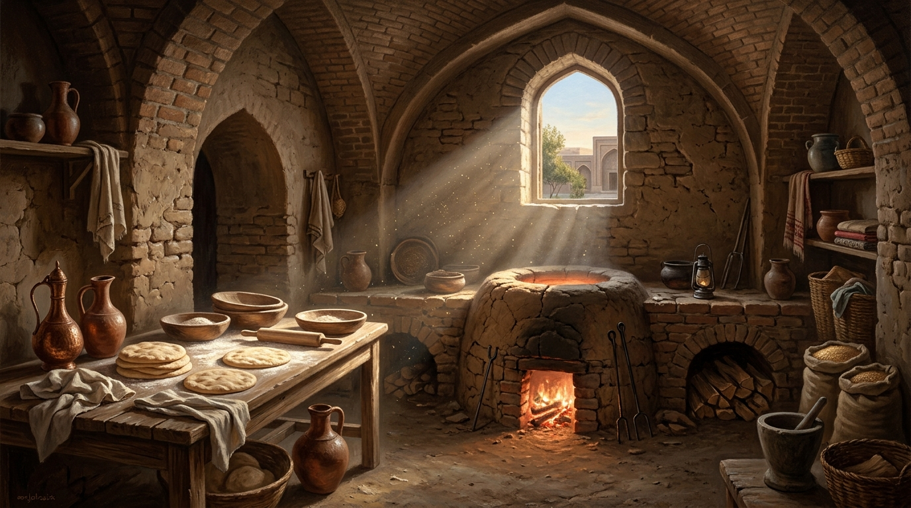
*17 Yaşında Dergâhta Hizmet ve Tandır (Tenur) Hadisesi — "Ceddinden bir veraset olarak onun elinin değdiği şeyi ateş yakmaz"*

</div>

Şah-ı Nakşibend henüz 17 yaşında bir delikanlı iken dergahta hizmet etmekte ve fırında (tandır/tenur) ekmek pişirmektedir. Herkes hazırladığı hamuru tandırın kızgın duvarına yapıştırıp pişirirken, Hazret’in yapıştırdığı hamurlar bir türlü pişmez, hamur kalır. Durum dergahın piri **Muhammed Baba Semmasi Hazretleri**’ne intikal ettirildiğinde, o büyük veli irsiyet hakikatini şu sözlerle açıklar:

> *"O, Dedesi Peygamber'in soyundandır. Ceddinden bir veraset olarak onun elinin değdiği şeyi ateş yakmaz."*

Ardından mürşidinin talimatıyla genç Bahaeddin elini doğrudan kor alevlerin içine sokar; tandırdaki ateşin geriye çekildiği ve mübarek eline dokunmadığı görülür.

> [!IMPORTANT]
> **Yanlış Bilinen Bir Hakikat: Tarikatın İcadı Değil, İhyası**  
> Burada önemli bir edebi ve tarihi düzeltmeyi yapmak gerekir: **Şah-ı Nakşibend Hazretleri yeni bir tarikatın kurucusu ya da sıfırdan bir yol icat eden bir "mucit" değildir.** Söz konusu seyr-ü sülûk yolu (*Sıddîkiyye / Tayfûriyye / Hâcegâniyye*), kendisinden çok önce de var olan hak bir yoldur. Ancak onun döneminde manevi tasarrufuyla o kadar geniş coğrafyalara yayılmış ve kitleleri derinden etkilemiştir ki, bu yol artık onun adıyla (**Nakşibendiyye**) anılmaya başlanmıştır.

---

## 💧 3. Tevazu ve Hakiki Keramet Anlayışı

Manevi yolculuğunun başlarında, gurur ve kibrin tamamen kırılması için **yedi yıl** boyunca yolları temizlemiş, hastalarla ve hatta yaralı sokak hayvanlarıyla ilgilenerek nefsiyle olan mücadelesini en derin tevazu örnekleriyle taçlandırmıştır. O, kerameti uçmakta veya kaçmakta değil, **istikamette** aramıştır.

Sığ bir keramet beklentisi içinde olan modern veya klasik zihinler için Şah-ı Nakşibend’in duruşu sarsıcı bir ders niteliğindedir. Bir gün bir ziyaretçi Hazret’e yaklaşarak meramını dile getirir:
> *"Efendim, manevi derecenizin ne denli ali olduğunu biliyoruz. Böyleyken sizden niçin hiç olağanüstü bir hal, bir keramet zuhur etmiyor?"*

Şah-ı Nakşibend Hazretleri, benliğini tamamen *fenâ fillâh* makamında eritmiş bir arifin tevazusuyla şu cevabı verir:

> ***"Bu kadar günahla ayakta duruyoruz, bundan büyük keramet mi olur?"***  
> *(Bir başka rivayette: "Bizim kerametimiz açıktır; omuzlarımızda bunca günah ve isyan yükü varken hâlâ yeryüzünde yürüyebiliyoruz, yerküre bizi yutmuyor, bundan büyük keramet mi olur!")*

### 🕯️ "Bu Muhabbet Bizden Size mi, Sizden Bize mi?"

Hazret’in irşad halkasında mürşid ile mürid arasındaki sevgi de kişisel bir başarı değil, tamamen ilahi bir lütuftur. En yakın halifesi ve damadı **Alaaddin Attar Hazretleri** ile aralarında geçen şu diyalog, bu ince hakikati özetler:

— **Şah-ı Nakşibend:** *"Alaaddin, bu muhabbet bizden size mi, yoksa sizden bize mi?"*  
— **Alaaddin Attar:** *"Efendim, sizden lütuf olabilir ama bizden de sevmek... Yani bizdendir."*  
— **Şah-ı Nakşibend:** *"Bekle ve gör."*

Bu kısa konuşmanın hemen ardından Şah-ı Nakşibend Hazretleri manevi teveccühünü çeker. Adeta görünmez bir fiş prizden çekilmiş gibi Alaaddin Attar’ın içindeki bütün aşk ve muhabbet hissi bir anda buharlaşır; kalbi bomboş kalır. Düştüğü dehşet karşısında ne yapacağını bilemeyen Alaaddin Attar, mürşidinin ayağına kapanarak hakikati itiraf eder:

> *"Efendim, her şey sizdendir! Siz isterseniz biz severiz, isterseniz onu sevmeye bile iktidarımız yetmez..."*

---

## 🧭 4. Seyr-ü Sülûk Yolu: Mürşidleri ve Manaya Doğuş

Görsel veya yazılı medyada sık sık insanların fiziki doğum günlerinin mumlarla kutlandığına şahit olursunuz. Oysa tasavvuf geleneği insanı sarsıcı bir hakikatle yüzleştirir: Bir insanın annesinden doğması yalnızca biyolojik bir başlangıçtır; asıl doğum, bir mürşid-i kâmil eliyle kalbin uyanması, yani **"manaya doğuş"**tur.

1318 (H. 718) yılında Buhara yakınlarındaki *Kasr-ı Hinduvan* (daha sonra onun bereketiyle **Kasr-ı Ârifân** — Arifler Köşkü/Sarayı adını almıştır) köyünde dünyaya gelen Şah-ı Nakşibend Hazretleri’ni manaya doğuran ve silsilesini şekillendiren sacayakları şunlardır:

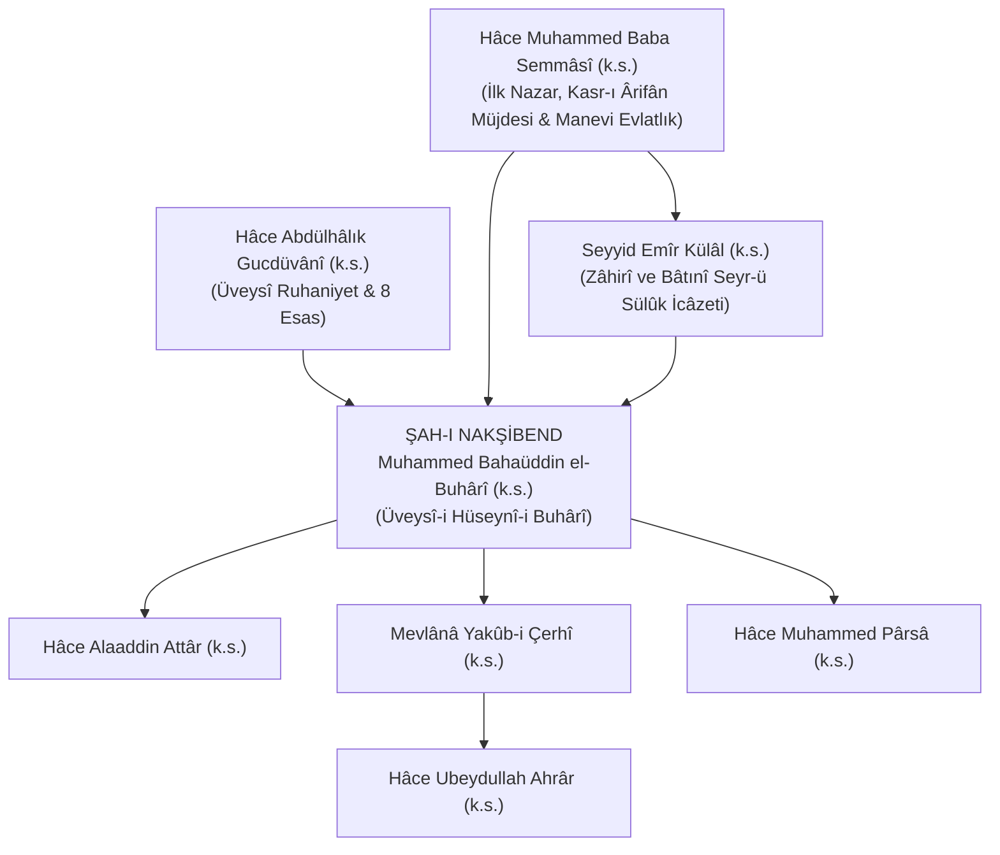

* **Muhammed Baba Semmâsî (k.s.):** Hazret henüz anne karnındayken, müridleriyle evin önünden geçen Baba Semmasi durur ve *"Buradan bir veli kokusu geliyor, bu ev yakın zamanda Kasr-ı Arifan (Ariflerin Sarayı) olacak"* müjdesini verir. Doğumundan itibaren de onun ilk piri ve manevi terbiyecisi olur.
* **Seyyid Emîr Külâl (k.s.):** Baba Semmasi Hazretleri’nin vasiyeti üzerine genç Bahaüddin’in zahiri ve batıni seyr-ü sülûk terbiyesini kemâle erdiren büyük mürşididir.
* **Abdülhâlık Gucdüvânî (k.s.):** Aralarında yaklaşık 300 yıllık bir zaman dilimi bulunmasına rağmen, Şah-ı Nakşibend Hazretleri onun ruhaniyetinden beslenip eğitilmiş ve gizli (hafi) zikri bu yolla yeniden ihya etmiştir. Bu sebeple tasavvuf literatüründe kendisi **"Üveysî-i Hüseynî-i Buhârî"** unvanıyla anılır.
* **Öz Babası ile Olan Manevi Diyalog:** Şah-ı Nakşibend Hazretleri, kendi öz babasının mürşididir ve babası ona rabıta yapmaktadır. Yaşlılığın verdiği titizlikle babasının sofilere biraz sert davranması üzerine Hazret onu nezaketle uyarır. Babasının *"Oğlum, sen kim oluyorsun, ben senin babanım!"* çıkışına karşı, şu tarihi sınırı çizer:
  > *"Maddede sen benim babamsın ama manada ben senin babanım."*

---

## ⚖️ 5. Hayatın İçinde Hak ile Olmak: İki Temel Tasavvufi Düstur

<div align="center">

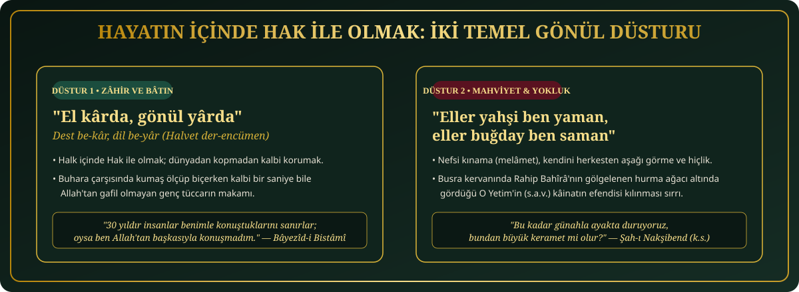

</div>

Şah-ı Nakşibend Hazretleri, insanı dünyadan ve üretimden koparan münzevi bir zühd anlayışını reddetmiş; gündelik hayatın tam merkezinde maneviyatı yaşamayı esas alan iki büyük düstur vazetmiştir:

### Düstur 1: "El kârda, gönül yârda" (*Dil be-yâr, dest be-kâr / Dil be-kâr, dest be-kâr*)

<div align="center">

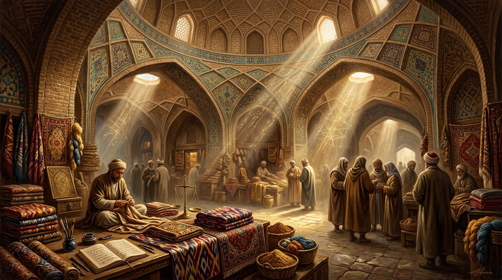
*"El kârda, gönül yârda" (Dest be-kâr, dil be-yâr) — Buhara Çarşısında Halk İçinde Hak İle Olmak*

</div>

Bu kural, **"halk içinde Hak ile olmak"** (*halvet der-encümen*) anlayışıdır. Bedenen çarşıda, pazarda, işte veya ticarette çalışırken kalbin kesintisiz bir biçimde Allah ile beraber olmasıdır.

Şah-ı Nakşibend Hazretleri Buhara çarşısında kumaş satan, ölçen, biçen, para alıp veren genç bir tüccarı izler. Sofilerine dönerek:
> *"Maşallah! Yarım saattir yoğun bir şekilde alışveriş yapıyor ama gönlü bir an bile Allah'tan kopmadı"* der.

Nitekim **Bayezid-i Bestami Hazretleri** de aynı manevi makamı şu sözüyle özetlemiştir:
> *"30 yıldır insanlar benimle konuştuklarını sanırlar; oysa ben Allah'tan başkasıyla konuşmadım."*

Ancak dış dünyada aktif bir biçimde var olurken kalbi koruyabilmek, ancak iç dünyada benliği tamamen yok etmekle mümkündür. İşte bu denge, ikinci düstur ile sağlanır:

### Düstur 2: "Eller yahşi ben yaman, eller buğday ben saman"

Bu düstur; nefsi kınama (*melâmet*), kendini herkesten aşağı görme ve **mahviyet** durağıdır. İnsanın gözden düşmeyi, kınanmayı ve yok olmayı göze alabilmesidir.

Bu yolun en büyük örneği bizzat **Hz. Peygamber’in (s.a.v.)** hayatında gizlidir. İslam öncesi Mekke toplumunda *"yetim ve çoban"* olmak en büyük sosyal mahrumiyet sayılırdı; yetimlere kız verilmez, ticaret kervanlarında hürmet gösterilmezdi. Nitekim amcası Ebu Talib, Şam kervanına çıkarken yetim olduğu için Utbe bin Rebia gibi kabile liderlerinden çekinmiş ve küçük Muhammed’i (s.a.v.) yanına almak istememiştir. Yengesinin ısrarıyla kervana katılan Efendimiz, deve bakıcısı olarak kervanın en arkasında bırakılmıştır.

Kervan Busra’ya ulaştığında **Rahip Bahira**, kurumuş bir hurma ağacının altına oturan 12 yaşındaki o çocuğun üzerine dalın eğildiğini ve onu gölgelediğini fark eder. Bahira, Ebu Talib’in yanına giderek sorar:

— **Rahip Bahira:** *"Bu çocuk senin neyindir?"*  
— **Ebu Talib** *(dönemin toplumsal ayıplamasından çekinerek)*: *"Oğlumdur."*  
— **Rahip Bahira** *(Kitap'tan öğrendiği hakikatle anında düzelterek)*: *"Hayır, onun babası ölmüş olmalı, İncil’de böyle yazar!"*

Mekke cahiliyesinin *"Yetimden peygamber mi olur?"* diyerek hor gördüğü O Yetim, Cenâb-ı Hakk’ın katında kâinatın en aziz varlığı kılınmıştır. **"Saman" olmayı ve yokluğu kabul etmeyenler, ilahi azametle bezenemezler.**

---

## 🏛️ Tarikatın 11 Temel Prensibi (Kelimât-ı Kudsiyye)

<div align="center">

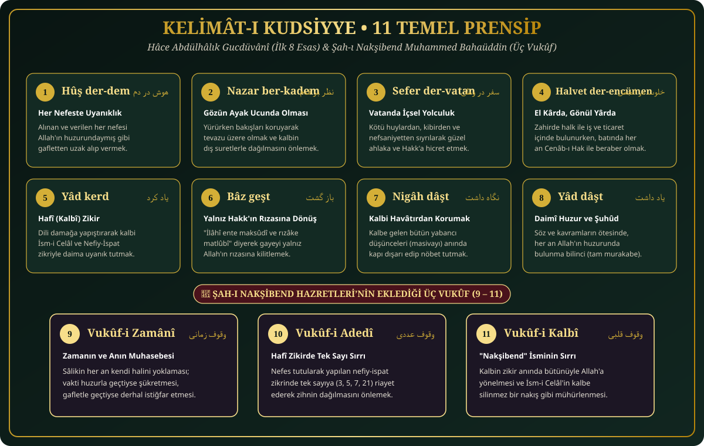

</div>

Nakşibendiyye yolunun üzerine bina edildiği, ilk sekizi **Abdülhâlık Gucdüvânî** Hazretleri’ne ait olan ve **Şah-ı Nakşibend** Hazretleri’nin üç esas (*vukûf*) daha ekleyerek tamamladığı **11 Temel Düstur** (detaylı şerhi için bkz. [`03_Kelimat-i_Kudsiyye/11_Esas_Detayli_Aciklamasi.md`](./03_Kelimat-i_Kudsiyye/11_Esas_Detayli_Aciklamasi.md)):

| # | Düstur | Farsça Aslı | Anlamı ve Tasavvufi Hakikati |
| :-: | :--- | :---: | :--- |
| **1** | **Hûş der-dem** | هوش در دم | Her nefeste uyanık olmak; alınan ve verilen her nefesi Allah'ın huzurundaymış gibi gafletten uzak alıp vermek. |
| **2** | **Nazar ber-kadem** | نظر بر قدم | Yürürken gözün ayak ucunda olması. Hem tevazunun gereğidir hem de lüzumsuz şeyleri görerek kalbin dağılmasını (*masivayı*) engeller. |
| **3** | **Sefer der-vatan** | سفر در وطن | Kötü huylardan, kibirden ve nefsaniyetten sıyrılarak güzel ahlaka, Allah'a doğru yapılan içsel hicret. |
| **4** | **Halvet der-encümen** | خلوت در انجمن | Zahirde halk ile, sosyal hayatın tam içinde esnaf, memur, öğrenci iken; batında (kalpte) Hak ile beraber olmak (*El kârda, gönül yârda*). |
| **5** | **Yâd kerd** | ياد كرد | Dili ve kalbi zikirle meşgul etmek, Hakk'ı anmayı kalbin doğal nefesi haline getirmek. |
| **6** | **Bâz geşt** | باز گشت | Zikir esnasında *"İlâhî, ente maksûdî ve rızâke matlûbî"* (Rabbim, gayem Sensin ve isteğim Senin rızandır) düşüncesine dönmek. |
| **7** | **Nigâh dâşt** | نگاه داشت | Kalbe gelen iyi veya kötü bütün yabancı düşünceleri (*havâtır*) anında kapı dışarı edip kalbi ağyardan korumak. |
| **8** | **Yâd dâşt** | ياد داشت | Her an, mekansız ve zamansız bir şekilde Allah'ın huzurunda olduğunun bilincinde (tam murakabe ve şuhûd) olmak. |
| **9** | **Vukûf-i zamânî** *(Şah-ı Nakşibend)* | وقوف زمانى | Zamanın nasıl geçtiğinin, anın farkında olmak. Nefes zikirle mi geçti gafletle mi, her an muhasebesini yapmak. |
| **10** | **Vukûf-i adedî** *(Şah-ı Nakşibend)* | وقوف عددى | Hafi (gizli) zikirde tek sayıya riayet ederek kalbin dikkatini toplamasına yardımcı olmak. |
| **11** | **Vukûf-i kalbî** *(Şah-ı Nakşibend)* | وقوف قلبى | Kalbin zikir anında bütünüyle zikredilene (Allah'a) yönelmesi ve o noktada kilitlenmesi. |

---

## 💎 Altın Sözleri ve İrşadları (Hikmet Damlaları)

Onun yolu, Kur'an ve Sünnet'e kıl payı kadar dahi aykırı düşmemek üzerine kuruludur (26+ sözün tam derlemesi için bkz. [`04_Sohbetler_ve_Menkibeler/Hikmetli_Sozleri.md`](./04_Sohbetler_ve_Menkibeler/Hikmetli_Sozleri.md)):

* **Sünnete İttiba ve İstikamet Üzerine:**
  > *"Bizim yolumuz, Urvetü'l-Vüska'dır (sağlam kulp). O kulp, Resulullah'ın (s.a.v.) sünnetine ve ashabının yoluna sımsıkı sarılmaktır. Kıl kadar Sünnet'ten ayrılan, bizim yolumuzdan sapmıştır."*

* **Yolun Esası ve Sohbet Üzerine:**
  > *"Bizim tarikatımız sohbettir. Halvette şöhret, şöhrette afet vardır. Hayır, bereket ve ihlas ise cemiyette, müminlerle bir arada hak yolda yürümektedir."*

* **Amel ve İhlas Üzerine:**
  > *"Bir kalpte iki sevgi barınmaz. Gönül evinde O'ndan başkasına yer yoktur. Her ne ki Allah'tan gayrıdır, onu kalpten silip atmak gerekir."*

* **Tevazu ve Hiçlik Üzerine:**
  > *"Âlem buğday, ben saman; âlem yahşi, ben yaman."* (Eller yahşi ben yaman, eller buğday ben saman.)

* **Helal Lokma Üzerine:**
  > *"Yenilen lokma gafletle elde edilmiş ve gafletle pişirilmişse, o lokmayı yiyenin kalbinde karanlık ve gaflet hasıl olur. İbadetin temeli helal lokmadır."*

---

## 🌟 6. Gölgesinde Yetişen Yıldızlar: Yetiştirdiği Büyük Halifeler

Şah-ı Nakşibend Hazretleri, tek bir nazarıyla muhatabına onlarca yıllık mücahedeyle kazanılamayacak halleri lütfedecek yüksek bir manevi tasarrufa sahipti. Onun rahle-i tedrisinde yetişip insanlığın yolunu aydınlatan ana halifeleri şunlardır:

1. **Alaaddin Attâr Hazretleri (k.s.):** Zengin bir bey çocuğu ve konaklarda büyümüş bir şehzade olmasına rağmen, 12 yaşında Şah-ı Nakşibend’e meftun olarak ailesini ve servetini terk etmiştir. Hazret onun hakkında *"Kurt kapmasın diye bakıyorum"* ve *"Baktıkça Kâbe'yi görüyorum"* buyurmuştur. Gururunu tamamen kırmak için Buhara pazarında elma satmakla görevlendirilmiştir. Attar, eski komşularının kendisini elma satarken görüp utançla pencerelerini kapattıklarını söyleyince, Şah-ı Nakşibend tarihe geçen şu mahzun ifadeyi kullanır: ***"Keşke senin ne sattığını bilseydiler Alaaddin!"*** Hazret, daha sonra kızını onunla evlendirmiş ve kendisinden sonraki en büyük halifesi kılmıştır.
2. **Yakûb-i Çerhî Hazretleri (k.s.):** Dönemin büyük hadis âlimi ve şairidir. Şah-ı Nakşibend’in huzuruna onu öven 60 beyitlik mükemmel bir kaside ile gelir. Hazret’in *"Çok şöhret sahibinde iş yoktur, Allah'ın velileri gizli olur"* uyarısına karşılık, bir hadis âlimi vakuruyla *"Allah sevdiği kulunu insanlar arasında da aziz kılar"* hadis-i şerifini okuyarak teslim olmuş ve silsilenin en büyük halkalarından biri haline gelmiştir.
3. **Ubeydullah Ahrâr Hazretleri (k.s.):** Şah-ı Nakşibend Hazretleri’nin manevi nefesini soluyan ve Silsile-i Aliyye’nin meşalesini Maveraünnehir’den Orta Asya’nın en ücra köşelerine kadar taşıyan aziz halifelerindendir.
4. **Muhammed Pârsâ (Paris) Hazretleri (k.s.):** Kendi döneminde zahiri ve batıni ilimlerde derinleşmiş, *Risâle-i Kudsiyye* ve *Faslül-Hitâb* gibi temel eserleri kaleme alarak binlerce müridin irşadına vesile olan en önemli sütunlardan biridir.

---

## 🔗 Altın Silsile (Silsile-i Zeheb)

<div align="center">

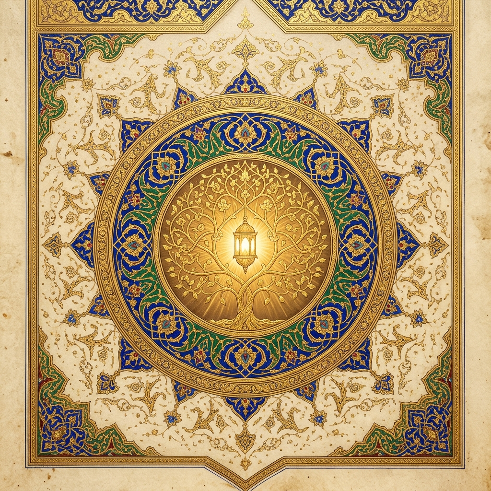
*Silsile-i Zeheb (Altın Silsile) — Tezhip ve Nur Ağacı*

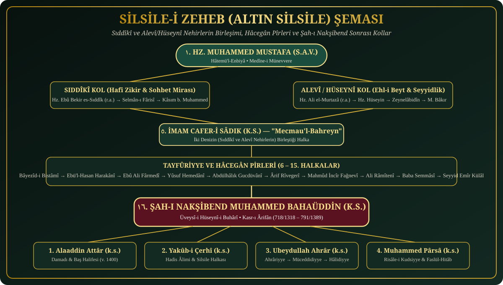

</div>

Nakşibendiyye yolu, silsilesi itibarıyla **Hz. Ebû Bekir es-Sıddîk (r.a.)** Efendimiz’e ve **Hz. Ali el-Murtazâ (r.a.)** kanalıyla Ehl-i Beyt’e dayanır. Sıddîkî kol, yolun gizli zikri (Hira ve Sevr Mağarası'ndaki kalbî maiyyet ve gizlilik) esas almasının kökenidir:

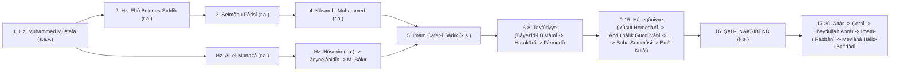

*(30 halkalık tam kronolojik tablo ve türbe yerleri için [`02_Silsile-i_Zeheb/Tam_Silsile_Tablosu.md`](./02_Silsile-i_Zeheb/Tam_Silsile_Tablosu.md) dosyasına bakınız.)*

---

## ⏳ Kronolojik Hayat Çizelgesi (718/1318 – 791/1389)

<div align="center">

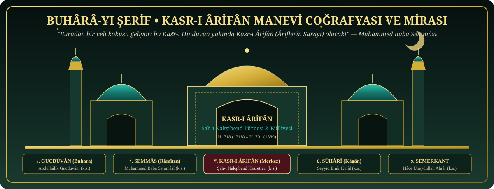

</div>

| Tarih (Hicrî / Milâdî) | Yaş | Tarihi Hadise ve Manevi Dönüm Noktası |
| :---: | :-: | :--- |
| **718 Öncesi** | — | Hâce Muhammed Baba Semmâsî Hazretleri’nin *Kasr-ı Hinduvân*’dan geçerken *"Buradan bir veli kokusu geliyor, burası Kasr-ı Ârifân olacak"* müjdesini vermesi. |
| **14 Muharrem 718 / Mart 1318** | 0 | Buhara yakınlarındaki **Kasr-ı Ârifân**’da dünyaya teşrifi ve üç günlükken Baba Semmâsî tarafından manevi evlatlığa kabul edilmesi. |
| **735 / 1335** | 17 | Dergâhta hizmet ederken **Tandır (Tenur) Kerameti**nin zuhur etmesi; elinin değdiği hamuru ve mübarek elini ateşin yakmaması. |
| **736 / 1336** | 18 | Evliliği, Semmâs’ta Baba Semmâsî Hazretleri’nin huzurunda ilk büyük cezbe ve edep dersini alması; **Abdülhâlık Gucdüvânî**’den Üveysî feyiz alışı. |
| **755 / 1354** | 36 | İlk piri Hâce Muhammed Baba Semmâsî’nin vefatı ve **Seyyid Emîr Külâl**’in yanında seyr-ü sülûkunu kemale erdirmesi. |
| **756–768 / 1355–1367** | 37–49 | Kusem Şeyh ve Halîl Ata ile görüşmesi; ardından **7 yıl boyunca** hastalara, yaralı hayvanlara hizmet ve yolları temizleme mücahedesi. |
| **772 / 1370** | 52 | Seyyid Emîr Külâl Hazretleri’nin kendisini irşada mezun kılıp vefat etmesi; Şah-ı Nakşibend’in **Birinci Hac** yolculuğu. |
| **775–785 / 1373–1383** | 55–65 | Hâce Muhammed Pârsâ refakatinde **İkinci Hac** yolculuğu; Herat, Merv ve Hicaz sohbetleri; Buhara’da irşad halkasının kıtalara yayılması. |
| **3 Rebîülevvel 791 / 2 Mart 1389** | 71 (H. 73) | **Kasr-ı Ârifân**’da Pazartesi gecesi Rahmet-i Rahmân’a kavuşması (*"Şah-ı Nakşibend"* = H. 791). |

---

## 🖋️ Âlimler, Mütefekkirler ve Aydınların Gözüyle Şah-ı Nakşibend

<div align="center">

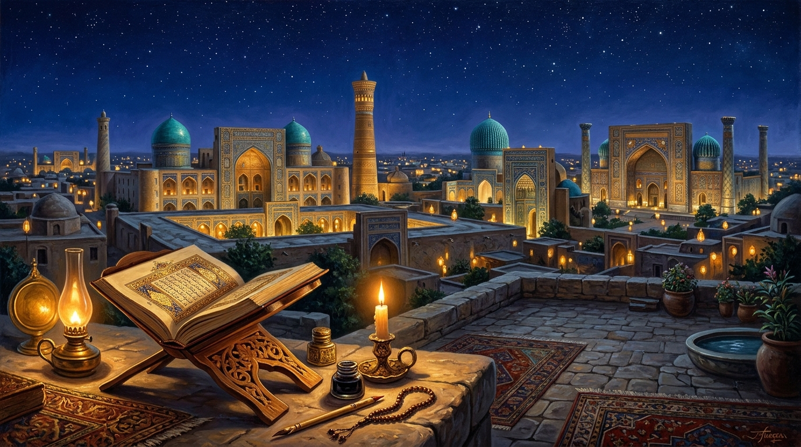
*Semerkant ve Buhara-yı Şerif — Âlimlerin, Âriflerin ve Mütefekkirlerin Gözüyle Şah-ı Nakşibend*

</div>

Asırlar boyunca İslam dünyasının en büyük âlimleri, arifleri ve şairleri ile Türk-İslam düşünce hayatının öncü mütefekkir ve aydınları, **Şah-ı Nakşibend Hazretleri**’nin büyüklüğünü, Sünnet-i Seniyye hassasiyetini ve *"El kârda, gönül yârda"* medeniyet tezini şu sözlerle ifade etmişlerdir *(tam derleme için bkz. [`06_Makaleler_ve_Tezler/Aydinlar_ve_Alimlerin_Gozuyle.md`](./06_Makaleler_ve_Tezler/Aydinlar_ve_Alimlerin_Gozuyle.md))*:

### 🏛️ Klasik Dönem Âlim, Şair ve Kutubları

* **İmam-ı Rabbânî Ahmed Fârûkî Serhendî (k.s.)** *(İkinci Bin Yılın Müceddidi — Mektûbât-ı Rabbânî)*:
  > *"Hâce Bahaüddin Nakşibend (k.s.) Hazretleri’nin yolu, Ashâb-ı Kirâm’ın (r.anhüm) yolunun ta kendisidir. Diğer yollarda sülûkun en sonunda ulaşılan kalbî nispet ve huzur, onun bereketli yolunda daha ilk adımda (**indirâcü'n-nihâye fi'l-bidâye**) sohbetle ele geçer. O, Sünnet-i Seniyye’ye ittibada ve bid'atlerden kaçınmakta velayet ufkunun zirvesidir."*

* **Mevlânâ Abdurrahman Câmî (k.s.)** *(XV. Asrın Büyük Âlimi, Mütefekkiri ve Şairi — Nefahâtü'l-Üns)*:
  > *"Sikke-i merdân-ı Hudâ Nakşibend / Der dil-i mâ nakş-ı Hudâ Nakşibend."*  
  > *(Allah erlerinin kalbine vurulan ilahi mühür Nakşibend’dir; bizim gönlümüze Allah’ın nakşını işleyen de Şah-ı Nakşibend’dir. O, kulluk ve mahviyet perdesi altında ilahi sırları gizleyen, zahirini halk ile bâtınını Hak ile süsleyen velayet şahıdır.)*

* **Emîr Ali Şîr Nevâî** *(Türk Edebiyatının Büyük Şairi ve Devlet Adamı — Nesâyimü'l-Mahabbe)*:
  > *"Hâce Bahaüddin Nakşibend, Türkistan ve Maveraünnehir semasının sönmez güneşi, ilahi aşk nakşını gönül levhasına vuranların şahıdır. Onun mübarek nefesiyle yalnız Buhara toprağı değil, bütün İslam âlemi yeniden dirilmiştir."*

* **Mevlânâ Hâlid-i Bağdâdî (k.s.)** *(Hâlidiyye Kolunun Pîri ve Müceddid — Dîvân)*:
  > *"Şah-ı Nakşibend, kalp aynasını masiva pasından temizleyip oraya Lafza-i Celâl’i nakşeden sultanımızdır. Onun kapısına baş koyan, doğrudan Sıddîk-ı Ekber’in (r.a.) ve Resûl-i Ekrem’in (s.a.v.) izine basmış olur."*

### 📚 Çağdaş Mütefekkirler, Edebiyatçılar ve Akademisyenler

* **Necip Fazıl Kısakürek** *(Şair ve Mütefekkir — Başbuğ Veliler)*:
  > *"Velilerden bir ordu kurulsa ve bunların başbuğlarından da ayrı bir ordu kurulsa hepsinin komutanı Şah-ı Nakşibend olur. O, Peygamber Efendimiz’in (s.a.v.) bâtın nurunu Hz. Ebû Bekir kanalıyla süzüp kalplere nakşeden, tasavvufta sahte taşkınlıkları silip tam Şeriat ve Sünnet ölçüsünü (Urvetü'l-Vüskâ) hâkim kılan en büyük kutuptur."*

* **Sezai Karakoç** *(Şair ve Mütefekkir — Diriliş Düşüncesi)*:
  > *"Buhara ve Semerkant’tan yükselen Hâcegân ve Şah-ı Nakşibend ruhu, İslam medeniyetinin Moğol istilası gibi en ağır yıkımlardan sonra yeniden ayağa kalkışının manevi mimarı olmuştur. Onun 'El kârda, gönül yârda' ilkesi, İslam insanının hem dünyayı imar eden hem de kalbini sonsuzluğa bağlayan en sağlam medeniyet tezidir."*

* **Nurettin Topçu** *(Ahlak Felsefecisi ve Mütefekkir)*:
  > *"Hakiki tasavvuf, dünyadan kaçıp miskinleşmek değil; bilakis Şah-ı Nakşibend’in 'El kârda, gönül yârda' düsturunda ifadesini bulan, hareketin, emeğin ve çalışmanın tam kalbinde Allah ile beraber olma ahlakıdır."*

* **Prof. Dr. Mahmud Es'ad Coşan** *(Akademisyen ve Mutasavvıf)*:
  > *"Şah-ı Nakşibend Hazretleri, dervişliği köşeye çekilip halktan kopmak olmaktan çıkarmış; esnafın dükkânında, âlimin medresesinde, çiftçinin tarlasında her nefeste Allah’ı unutmayacak bir kalp uyanıklığı (hûş der-dem) mektebi kurmuştur."*

* **Ord. Prof. Dr. M. Fuad Köprülü** *(Tarihçi — Türk Edebiyatında İlk Mutasavvıflar)*:
  > *"Hoca Ahmed Yesevî ile başlayan Orta Asya tasavvuf geleneği, XIV. asırda Buhara’da Bahaeddin Nakşibend ile Sünnî-Şer'î istikametini en sağlam şekilde tahkim etmiş; Türkistan’dan Osmanlı Anadolu’suna ve Balkanlar’a kadar İslam kültür ve medeniyetinin manevi omurgasını oluşturmuştur."*

* **Prof. Dr. Hamid Algar** *(Kaliforniya Üniversitesi / Berkeley — TDV İslâm Ansiklopedisi)*:
  > *"Bahâeddin Nakşibend, İslam tarihinde tasavvufu Kur'an ve Sünnet disipliniyle en berrak şekilde bütünleştiren, gösterişli keramet beklentilerini reddederek içsel uyanıklığı (hûş der-dem) toplumsal sorumlulukla (halvet der-encümen) birleştiren eşsiz bir manevi ihya önderidir."*

* **Prof. Dr. Necdet Tosun** *(Tasavvuf Tarihi Profesörü — Bahâeddîn Nakşbend)*:
  > *"Bahâeddîn Nakşbend; tevazuu, halktan biri gibi sade yaşayışı, el emeğiyle geçinmeyi ve Sünnet-i Seniyye’ye titizlikle bağlılığı esas alarak tasavvuf tarihinde yeni bir çığır açmış; onun manevi mirası Orta Asya’dan Osmanlı’ya, Hindistan’dan Kafkasya’ya kadar üç kıtayı şekillendirmiştir."*

---

## 🕯️ 7. Sonuç: Yokluğa Talip Olmak ve Kalbe Düşen Hikmet

<div align="center">

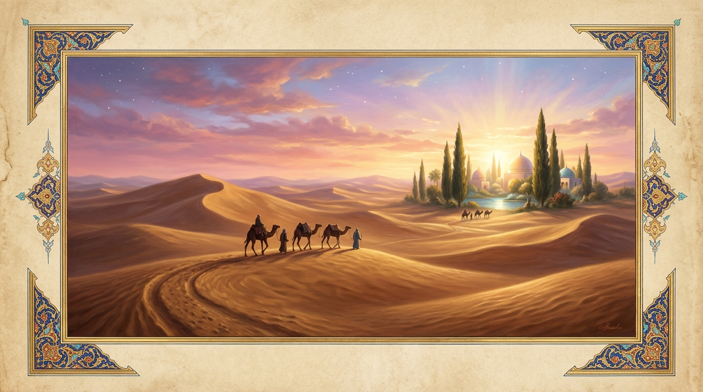
*"Sonsuzluk Kervanı, peşinizde ben..." — Yokluğa Talip Olmak ve Manaya Doğuş*

</div>

Bugün her birimiz modern dünyada sürekli var olmaya, bir unvan kazanmaya, kendimizi tanıtmaya ve alkışlanmaya çalışıyoruz. Oysa Şah-ı Nakşibend Hazretleri’nin hayatı ve bıraktığı miras, bize bambaşka bir kapı aralıyor: **Var olmaya çalışmayı bırakıp yokluğa talip olmak.**

Mülkün sahibine kendi acziyetini teslim etmeden, benliği sıfırlamadan manevi derecelere ulaşmak imkânsızdır. Cumhuriyet dönemi Türk edebiyatının en mağrur, en dik duruşlu şairlerinden biri olan **Necip Fazıl Kısakürek**’i hatırlayalım... Devlet yetkililerinin İslam karşıtı bir beyanına *"O koku ciğerinizin çürümesinden geliyor!"* diyecek kadar pervasız ve cesur olan o kitleler sürükleyicisi mizaç, Allah’ın velilerinin kapısına geldiğinde nasıl bir ruh haline bürünüyordu?

*Sonsuzluk Kervanı* şiirindeki şu satırlar, Şah-ı Nakşibend’in vasiyet ettiği o **"saman olma"** hallerinin edebi zirvesidir:

> *"Sonsuzluk Kervanı, peşinizde ben,*  
> *Üç ayakla seken topal köpeğim.*  
> *Bastığınız yerleri taş taş öpeyim,*  
> *Bir kırıntı yeter kereminizden..."*

Devlet adamlarına boyun eğmeyen o devasız gurur, Mürşid-i Kâmillerin gölgesinde *"üç ayakla seken topal bir köpek"* olmayı şeref saymıştır.

Asıl mesele; takvimlerin belirttiği fiziki doğum günlerinde mum üflemek değil, bir Mürşid-i Kâmil’in nazarıyla uyanıp **manaya doğabilmektir.**

> **Ne mutlu elini helal kazançtan çekmeyip gönlünü Hak’tan ayırmayanlara...**  
> **Ve ne mutlu, kendisini kâinatın en aciz samanı bilip, o ilahi yokluğun içinde hakiki varlığa ulaşanlara...**

---

## 📂 Depo Yapısı (Repository Structure)

Arşivimiz modüler bir yapıda, derinlemesine okuma ve araştırmaya uygun şekilde tasarlanmıştır:

```text
bahauddin-naksibend-arsivi/
├── 01_Hayati/                  
│   ├── Dogumu_ve_Cocuklugu.md              # Kasr-ı Ârifân müjdesi, Seyyidliği ve 17 yaşındaki Tandır kerameti
│   ├── Seyr-u_Suluk_Donemi.md              # Baba Semmâsî, Emîr Külâl, Gucdüvânî (Üveysîlik) ve 7 yıllık hizmet
│   ├── Hac_Yolculuklari_ve_Seyahatleri.md  # İki hac seferi, Herat, Merv ve Hicaz meclisleri
│   └── Vefati_ve_Turbesi.md                # Vuslatı (791/1389), Kasr-ı Ârifân külliyesi ve yolun dönemleri
├── 02_Silsile-i_Zeheb/         
│   ├── Hulefa-yi_Rasidin_Baglantisi.md     # Sıddîkî ve Alevî/Hüseynî kolların İmam Cafer-i Sâdık'ta birleşmesi
│   ├── Hacegan_Donemi.md                   # Tayfûriyye ve Hâcegân pirleri
│   ├── Sah_i_Naksibend_Sonrasi_Kollar.md   # Dört büyük halifesi ve Ahrâriyye, Müceddidiyye, Hâlidiyye kolları
│   └── Tam_Silsile_Tablosu.md              # 30 halkalık tam kronolojik Silsile-i Zeheb cetveli
├── 03_Kelimat-i_Kudsiyye/      
│   ├── 11_Esas_Detayli_Aciklamasi.md       # 11 Kudsi Kelimenin Farsça asılları ve tasavvufi şerhi
│   └── Rabitatu_ve_Murakabe_Adabi.md       # Sohbet, Râbıta, Teveccüh ve Hatm-i Hâcegân usulü
├── 04_Sohbetler_ve_Menkibeler/ 
│   ├── Hikmetli_Sozleri.md                 # Konularına göre tasnif edilmiş 26+ hikmetli sözü
│   └── Menkibeler_ve_Kissalar.md           # Hz. Yusuf, Timur ve Hafız, Genç Tüccar, Rahip Bahira, Elma Satışı kıssaları
├── 05_Eserleri_ve_Evradlar/    
│   ├── Evrad-i_Bahaeddin.md                # Evrâd-ı Bahâiyye, Risâle-i Kudsiyye ve zikir usulü
│   └── Vasiyetleri.md                      # Manevi vasiyetleri ve Ehl-i Sünnet vurgusu
├── 06_Makaleler_ve_Tezler/     
│   ├── Akademik_Arastirmalar.md            # DİA maddeleri, doktora tezleri ve akademik monografiler
│   └── Aydinlar_ve_Alimlerin_Gozuyle.md    # Âlimler, şairler ve mütefekkirlerin Şah-ı Nakşibend hakkındaki sözleri
├── 07_Kavramlar_Sozlugu/       
│   └── Tasavvuf_ve_Hacegan_Istilahlari.md  # Biçun, Mahviyet, Melâmet, Üveysîlik vb. ıstılahlar sözlüğü
├── assets/                                 # Tezhip, minyatür ve mimari görseller (JPG & SVG)
│   ├── kasr-i-arifan-buhara.jpg            # Buhara-yı Şerif ve Kasr-ı Ârifân Külliyesi Görseli
│   ├── el-karda-gonul-yarda.jpg            # "El Kârda, Gönül Yârda" Buhara Çarşısı Görseli
│   ├── altin-silsile-tezhip.jpg            # Silsile-i Zeheb (Altın Silsile) Tezhip Sanat Görseli
│   ├── tandir-kerameti-dergah.jpg          # 17 Yaşındaki Tandır (Tenur) Kerameti ve Dergâh Görseli
│   ├── semerkand-buhara-ilim-gecesi.jpg    # Semerkant ve Buhara İlim-İrfan Gecesi Görseli
│   ├── sonsuzluk-kervani-mahviyet.jpg      # "Sonsuzluk Kervanı" ve Sefer der-Vatan Görseli
│   ├── hero-banner.svg                     # Şah-ı Nakşibend & Kasr-ı Ârifân Tezhip Kapak Görseli
│   ├── kelimat-i-kudsiyye.svg              # 11 Kelimât-ı Kudsiyye Görsel Tablosu
│   ├── silsile-i-zeheb.svg                 # Altın Silsile (Sıddîkî & Alevî Kollar) Mimari Şeması
│   ├── iki-temel-dustur.svg                # İki Temel Tasavvufi Düstur Görseli
│   └── kasr-i-arifan-kulliyesi.svg         # Buhara-yı Şerif ve Kasr-ı Ârifân Külliyesi İllüstrasyonu
├── index.html                              # İnteraktif Web Arşivi / Dijital Külliyat Arayüzü
├── Kaynakca.md                             # Enîsü't-Tâlibîn, Reşahât, Nefahâtü'l-Üns, Mektûbât vb. ana kaynaklar
├── KATKIDA_BULUN.md                        # Arşive nasıl destek olabileceğiniz hakkında rehber
└── LICENSE                                 # Açık kaynak lisansı ve vakıf şuuru beyanı
```

---

## 🤝 Katkıda Bulunmak (Contributing)

Bu arşiv, sıradan bir bilgi deposu değil, bir edep ve vakıf şuuruyla büyütülmektedir. Ehl-i Sünnet ve'l-Cemaat çizgisine uygun, muteber tarihi kaynaklara (örneğin; *Enîsü't-Tâlibîn*, *Reşahât Aynü'l-Hayât*, *Nefahâtü'l-Üns*, *Risâle-i Kudsiyye*, *Mektûbât-ı Rabbânî*) dayanan her türlü makale, alıntı, çeviri veya düzenleme önerileriniz için `Pull Request` (PR) gönderebilirsiniz.

Lütfen katkı yapmadan önce [KATKIDA_BULUN.md](./KATKIDA_BULUN.md) dosyasındaki edep ve doğrulama kurallarını inceleyin.

> *"Kim bizim yolumuza sevgiyle girer ve istikamet üzere olursa, Allah’ın izniyle hem dünyada hem ahirette saadet bulur."*

**Lisans:** Bu projedeki derlemeler açık kaynaklıdır ([MIT](./LICENSE)). Ancak amaç, ticari veya nefsani gayeler değil; bilginin ihlasla, edeple ve doğru bir şekilde, bozulmadan nesilden nesile aktarılmasıdır.
